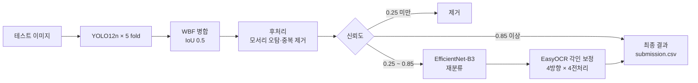

<h1 align="center">PILL SIGHT</h1>

<p align="center">
  <b>경구약제 사진에서 알약 73종의 위치와 이름을 찾는 4단계 객체 탐지 파이프라인</b><br>
  YOLO12n 5-Fold WBF · EfficientNet-B3 재분류 · EasyOCR 각인 보정
</p>

<p align="center">
  
  
  
  
</p>

코드잇 AI 엔지니어 10기 초급 프로젝트 · 해피 6팀 · 2026.04.20 ~ 05.11 (3주)

---

## 결과

| 지표 | 값 | 기준 |
|---|---|---|
| YOLO12n mAP50 | **0.9944** | 5-Fold 검증 데이터 평균 |
| YOLO12n mAP50-95 | **0.9847** | 5-Fold 검증 데이터 평균 |
| EfficientNet-B3 정확도 | **0.9980** | 잘라낸 알약 이미지 분류, 검증 데이터 |
| 테스트 이미지 수동 검수 | **알약 3,229개 중 클래스 오판 3건** | 테스트 이미지 832장을 팀원이 직접 확인 |

- 위 수치는 검증 데이터와 수동 검수 결과예요. 공식 채점 점수가 아니에요.
- 데이터와 모델을 함께 바꾸며 개선해서, 단계별 효과는 동일 조건에서 비교하지 못했어요.

## 문제와 접근

| 문제 | 접근 |
|---|---|
| 원본 232장으로 73개 클래스를 구분해야 함. 희귀 클래스는 3장, 많은 클래스는 150장 이상 | 약학정보원·AI Hub 기반 합성 증강 861장, OOD 카탈로그 20종, 데이터 11개 버전 |
| 색·모양이 거의 같고 각인만 다른 알약이 많음 | 저신뢰도 박스만 EfficientNet-B3로 재분류하고 EasyOCR로 각인 확인 |
| 이미지 모서리의 배경 곡면을 알약으로 오탐 | 경계 5px 안에서 두 변에 닿는 박스 제거 |
| 세로로 놓인 알약을 못 찾는 방향 편향 | 회전 증강 degrees 15 → 90, flipud 0.5 |

## 추론 파이프라인



- **신뢰도 0.85 이상**은 정밀도가 1에 가까워 그대로 출력해요. 추가 단계를 건너뛰어 속도를 지켜요.
- **0.25 ~ 0.85**만 재분류와 OCR로 다시 확인해요. 전체 박스의 약 37%예요.
- **OCR**은 EasyOCR 내장 회전 대신 이미지를 0·90·180·270도로 직접 돌려 읽어요. 내장 옵션이 세로 각인 'SK'를 'U'로 잘못 읽었기 때문이에요.

## 모델 변천

| 날짜 | 모델 | 바꾼 이유 |
|---|---|---|
| 04.21 | YOLO11s 단일 모델 | 베이스라인. 혼동행렬에서 비슷한 알약 간 오분류 확인 |
| 04.24 | YOLO11s 5-Fold + WBF | 약 1,000장 규모에서 단일 모델 과적합. 얼리스톱이 꺼진 설정(patience 0)도 수정 |
| 04.27 | + 후처리 필터 2종 | WBF 이후 모서리 오탐과 중복 박스 발생 |
| 04.28 | YOLO12s + EasyOCR | 외관은 같고 각인만 다른 약품 구분 |
| 04.29 | YOLO12n + EfficientNet-B3 2-Stage | 각인이 흐린 약품은 OCR로도 실패. 5개 fold 운용을 위해 nano로 경량화 |
| 05.04 | YOLO12n, imgsz 832 · batch 8 | 데이터 v11로 커진 뒤 RTX 4070 12GB에서 OOM 재발 |

<details>
<summary>최종 학습 설정</summary>

| 항목 | YOLO12n | EfficientNet-B3 |
|---|---|---|
| 입력 크기 | 832 | 300 |
| batch / epochs / patience | 8 / 150 / 30 | 64 / 150 / 30 |
| 옵티마이저 | SGD, lr0 0.01 | AdamW, lr 0.001 (2단계: 1e-4) |
| 손실·불균형 대응 | cls 1.5 | FocalLoss(γ=2, label smoothing 0.1), 클래스 가중치, WeightedRandomSampler |
| 증강 | degrees 90, flipud 0.5, hsv_s·hsv_v 0.2, mosaic 0.8, mixup 0.05, close_mosaic 30, copy_paste 0.5 | 회전·색 변화·블러·RandomErasing |
| 기타 | 5-Fold, seed 42 | 헤드만 10 epoch 학습 후 뒤쪽 블록(features[5:]) 미세조정 |

설정 파일: [`src/config.py`](src/config.py)

</details>

## 데이터

| 버전 | 핵심 변경 | 클래스 | 학습 이미지 |
|---|---|---|---|
| v1~v2 | 원본 수령, 중복 라벨 3건 수정 | 56 | 232장 |
| v3~v4 | 클래스 11개 추가, bbox 크롭 증강, OOD 12건 정리 | 67 | 232장 + 크롭 303장 |
| v5~v7 | PNG → JPG 경량화(용량 -83%), OOD 17종 | 67 | 232장 |
| v8~v9 | 약학정보원 기반 합성 증강 | 71 | 857장 |
| v10 | AI Hub 기반 합성, 촬영 각도 균등화 | 74 | 1,112장 |
| v11 | 끝까지 미인식된 코싹엘정 보강 | 73 | 1,093장 |

데이터는 저장소에 포함하지 않고, 폴더 구조만 [`data/`](data/)에 남겨 뒀어요.

## 팀

<table align="center">
  <tr>
    <td align="center" width="150">
      <br/>
      <b>Adam</b><br/>
      <a href="https://github.com/Adam-1228">@Adam</a>
    </td>
    <td align="center" width="150">
      <br/>
      <b>Eastar0102</b><br/>
      <a href="https://github.com/Eastar0102">@Eastar0102</a>
    </td>
    <td align="center" width="150">
      <br/>
      <b>heewon02</b><br/>
      <a href="https://github.com/heewon02">@heewon02</a>
    </td>
    <td align="center" width="150">
      <br/>
      <b>minjaejeon</b><br/>
      <a href="https://github.com/minjaejeon0827">@minjaejeon</a>
    </td>
    <td align="center" width="150">
      <br/>
      <b>기하</b><br/>
      <a href="https://github.com/wenttoofar">@기하</a>
    </td>
    <td align="center" width="150">
      <br/>
      <b>무심</b><br/>
      <a href="https://github.com/wjdtmdgh87-lgtm">@무심</a>
    </td>
  </tr>
</table>

| 이름 | 역할 | 맡은 일 |
|---|---|---|
| 정승호 [@wjdtmdgh87-lgtm](https://github.com/wjdtmdgh87-lgtm) | PM | 일정·역할 관리, 기술 방식 결정, 저장소 통합, 보고서·발표 |
| 임동규 [@Eastar0102](https://github.com/Eastar0102) | 모델 엔지니어 | YOLO 학습, WBF, 후처리, OCR, 2-Stage 분류기 |
| 송기하 [@wenttoofar](https://github.com/wenttoofar) | 실험 리드 | 실험·평가 프레임워크, 비교 실험 설계 |
| 성치용 [@Adam-1228](https://github.com/Adam-1228) | 데이터 엔지니어 | 데이터 버전 관리, 합성 증강, OOD 카탈로그 |
| 조희원 [@heewon02](https://github.com/heewon02) | 데이터 엔지니어 | 데이터 버전 관리, 합성 증강, OOD 카탈로그 |
| 전민재 [@minjaejeon0827](https://github.com/minjaejeon0827) | 웹 개발 | 시연용 웹 앱(Streamlit·FastAPI) |

## 실행 방법

```bash
pip install -r requirements.txt          # CUDA 환경은 requirements-cuda.txt 추가 설치
python main.py --mode train_all          # YOLO12n 5-Fold 학습 → models/fold*_best.pt
python main.py --mode crop_data          # Stage 2용 알약 크롭 생성
python main.py --mode train_stage2       # EfficientNet-B3 학습
python main.py --mode wbf --source data/images/test   # 전체 파이프라인 추론 + submission.csv
```

| 모드 | 설명 |
|---|---|
| `data` | split 목록 경로 보정과 데이터 통계 |
| `train` / `train_all` | fold 1 단일 학습 / fold 1~5 전체 학습 |
| `crop_data` / `train_stage2` | Stage 2 크롭 데이터 생성 / EfficientNet-B3 학습 |
| `predict` | 단일 모델 예측 (`--weights` 지정 가능) |
| `wbf` | 5-Fold WBF + 후처리 + Stage 2 + OCR 전체 파이프라인 |
| `experiment` / `experiment_all` / `compare` | `config/experiments/`의 YAML 실험 실행과 결과 비교 |

옵션: `--conf`(기본 0.25), `--no-ocr`, `--no-stage2`, `--exp <실험 이름>`

데이터 분할 구성은 `python check_split_v3.py`로 확인할 수 있어요.

## 저장소 구조

```
main.py                  실행 진입점 (모드 선택)
check_split_v3.py        fold별 split 구성과 누락 파일 검사
src/
  config.py              경로·하이퍼파라미터·Stage 2 설정
  dataset.py             split 경로 보정, Stage 2 크롭 생성
  model.py               YOLO 학습·예측
  wbf_ensemble.py        5-Fold WBF, 후처리 필터, 시각화, submission.csv
  crop_classifier.py     Stage 2 EfficientNet-B3 학습·추론
  ocr_correction.py      EasyOCR 각인 보정 (4방향 × 4전처리)
  experiment.py, eval/   YAML 실험 실행, 지표 정리, 실험 비교
config/experiments/      비교 실험 설정
code_mapping.csv         클래스 ↔ 약품명·각인 매핑
data_fold1~5.yaml        fold별 데이터 설정
docs/profiles/           보고서·발표자료
```

## 한계

- 검증 지표가 1.0에 가까워요. 합성·크롭 데이터가 fold 사이에 섞였다면 과대평가일 수 있어요.
- 표면이 마모됐거나 각인이 거의 없는 약, 학습에 없던 새 약은 여전히 틀릴 수 있어요.
- 데이터와 모델을 동시에 바꿔서 단계별 효과를 같은 조건에서 비교하지 못했어요.

## 문서

- [프로젝트 보고서 (PDF)](docs/profiles/6팀_보고서.pdf)
- [발표 자료 (PPTX)](docs/profiles/6팀_발표.pptx)
- 협업일지: [정승호](https://www.notion.so/348835bcc7588014bdb7d345644b534b) · [임동규](https://www.notion.so/6-_-_-34850973847880a49959d7639bbfec66?source=copy_link) · [전민재](https://www.notion.so/AI-_10-_-2_6-_AI-_-2026_04-05-34857454ec1d80d690c9d09c8165806f?source=copy_link) · [조희원](https://www.notion.so/6-Daily-35d57c90138b8005b36fc16e96cb7b28?source=copy_link) · [송기하](docs/profiles/%E1%84%80%E1%85%B5%E1%84%92%E1%85%A1.pdf) · [성치용](https://broken-a-lot-of-bone.tistory.com/category/%EC%B4%88%EA%B8%89%ED%94%84%EB%A1%9C%EC%A0%9D%ED%8A%B8_%EA%B2%BD%EA%B5%AC%EC%95%BD%EC%B2%B4_%ED%83%90%EC%A7%80)
