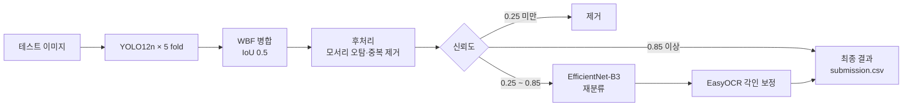

<h1 align="center">🔍 PILL SIGHT 알약 탐지 프로그램</h1>

<p align="center">
  <b>  ▎ YOLO 기반 알약 탐지 및 분류 시스템
  이미지 속 알약의 위치와 종류를 찾고,
  생김새가 비슷한 알약은 각인까지 읽어서 구분합니다. </b>
</p>

<p align="center">
  
  
  
</p>

---

## 👥 팀원 구성

<table align="center">
  <tr>
    <td align="center" width="150">
      <br/>
      <b>Adam</b><br/>
      <sub>성치용 · Data</sub><br/>
      <a href="https://github.com/Adam-1228">@Adam</a>
    </td>
    <td align="center" width="150">
      <br/>
      <b>Eastar0102</b><br/>
      <sub>임동규 · Model</sub><br/>
      <a href="https://github.com/Eastar0102">@Eastar0102</a>
    </td>
    <td align="center" width="150">
      <br/>
      <b>heewon02</b><br/>
      <sub>조희원 · Data</sub><br/>
      <a href="https://github.com/heewon02">@heewon02</a>
    </td>
    <td align="center" width="150">
      <br/>
      <b>minjaejeon</b><br/>
      <sub>전민재 · Web</sub><br/>
      <a href="https://github.com/minjaejeon0827">@minjaejeon</a>
    </td>
    <td align="center" width="150">
      <br/>
      <b>기하</b><br/>
      <sub>송기하 · Experiment</sub><br/>
      <a href="https://github.com/wenttoofar">@기하</a>
    </td>
    <td align="center" width="150">
      <br/>
      <b>무심</b><br/>
      <sub>정승호 · PM</sub><br/>
      <a href="https://github.com/wjdtmdgh87-lgtm">@무심</a>
    </td>
  </tr>
</table>

---

## 🛠 기술 스택

<p align="center">
  
  
  
  
  
  
  
  
</p>

---

## 📌 프로젝트 개요

- 기간: 2026.04.20 ~ 2026.05.11 (코드잇 AI 엔지니어 10기 초급 프로젝트)
- 목표: 경구약제 이미지에서 알약 73종의 위치와 이름 찾기
- 데이터: 원본 232장 + 합성 증강 861장 → 학습 1,093장 / 바운딩 박스 3,840개 / 테스트 842장

원본만으로는 클래스당 이미지가 너무 적었고(적은 클래스는 3장), 색과 모양이 거의 같은 알약이 많았습니다. 그래서 YOLO 하나로 끝내지 않고 앙상블, 후처리, 재분류, OCR을 단계별로 붙였습니다.

---

## 📊 결과

| 항목 | 결과 |
|---|---|
| YOLO12n mAP50 | 0.9944 |
| YOLO12n mAP50-95 | 0.9847 |
| EfficientNet-B3 val_acc | 0.9980 |
| 테스트 이미지 직접 검수 | 832장, 알약 3,229개 중 오분류 3건 |

※ mAP와 val_acc는 5-Fold 검증 데이터 기준입니다. 테스트 결과는 팀원이 추론 결과를 직접 확인한 수치입니다.

---

## 🔄 추론 파이프라인



1. 5개 fold 모델의 예측을 WBF로 합칩니다.
2. 이미지 모서리 배경을 알약으로 잡은 박스와 겹친 박스를 지웁니다.
3. 신뢰도 0.85 이상은 그대로 쓰고, 0.25~0.85 사이 박스만 EfficientNet-B3로 다시 분류합니다.
4. 마지막으로 EasyOCR로 각인을 읽어 `code_mapping.csv`와 대조합니다. 각인 방향이 제각각이라 이미지를 0·90·180·270도로 돌리고 전처리 4가지를 적용해 16번 읽습니다.

---

## 🧪 모델 변천

| 버전 | 날짜 | 변경 | 이유 |
|---|---|---|---|
| v0 | 04.21 | YOLO11s 단일 모델 | 베이스라인 |
| v1 | 04.24 | 5-Fold + WBF, 하이퍼파라미터 재조정 | 단일 모델 과적합, patience 0으로 얼리스톱이 꺼져 있던 문제 |
| v2 | 04.27 | 후처리 필터 2종 | WBF 이후 모서리 오탐, 중복 박스 |
| v3 | 04.28 | EasyOCR 추가, YOLO12s | 생김새는 같고 각인만 다른 알약 (게루삼엠정 / 알드린정) |
| v4 | 04.29 | EfficientNet-B3 2-Stage, YOLO12n | 각인이 흐린 알약은 OCR로도 못 잡음. 5개 모델을 돌리기 위해 nano로 변경 |
| v4+ | 05.04 | imgsz 832, batch 8 | 데이터 v11 적용 후 RTX 4070 12GB에서 OOM |

<details>
<summary>최종 학습 설정</summary>

**YOLO12n** (`src/config.py`)

- imgsz 832 / batch 8 / epochs 150 / patience 30
- SGD, lr0 0.01, cls 1.5
- degrees 90, flipud 0.5, hsv_s·hsv_v 0.2, mosaic 0.8, mixup 0.05, close_mosaic 30, copy_paste 0.5

**EfficientNet-B3** (`src/crop_classifier.py`)

- 입력 300 / batch 64 / epochs 150 / patience 30
- AdamW lr 0.001, 분류 헤드만 10 epoch 학습 후 `features[5:]`부터 lr 1e-4로 미세조정
- FocalLoss(γ=2, label smoothing 0.1) + 클래스 가중치 + WeightedRandomSampler

</details>

---

## 🗂 데이터 버전

| 버전 | 변경 내용 | 클래스 | 학습 이미지 |
|---|---|---|---|
| v1~v2 | 원본 수령, 중복 라벨 3건 수정 | 56 | 232 |
| v3~v4 | 클래스 11개 추가, bbox 크롭 증강, OOD 12건 정리 | 67 | 232 + 크롭 303 |
| v5~v7 | PNG → JPG 변환 (용량 83% 감소), OOD 17종 | 67 | 232 |
| v8~v9 | 약학정보원 데이터로 합성 증강 | 71 | 857 |
| v10 | AI Hub 데이터로 합성, 촬영 각도 균등화 | 74 | 1,112 |
| v11 | 인식이 안 되던 코싹엘정 보강 | 73 | 1,093 |

데이터 파일은 저장소에 올리지 않았고 폴더 구조만 남겨두었습니다.

---

## 📁 프로젝트 구조

```
📦 project-root
├── main.py                  # 실행 진입점
├── check_split_v3.py        # fold별 split 구성·누락 파일 확인
├── 📂 src/
│   ├── config.py            # 경로, 하이퍼파라미터, Stage 2 설정
│   ├── dataset.py           # split 경로 수정, Stage 2 크롭 생성
│   ├── model.py             # YOLO 학습 및 예측
│   ├── wbf_ensemble.py      # 5-Fold WBF, 후처리, submission.csv 생성
│   ├── crop_classifier.py   # Stage 2 EfficientNet-B3
│   ├── ocr_correction.py    # OCR 각인 보정
│   ├── experiment.py        # YAML 실험 관리
│   └── 📂 eval/             # 지표 정리, 시각화, 실험 비교
├── 📂 config/experiments/   # 비교 실험 설정
├── 📂 data/                 # images/, labels/, splits/
├── 📂 docs/profiles/        # 팀원 프로필, 보고서, 발표 자료
├── data.yaml, data_fold1~5.yaml
└── code_mapping.csv         # 클래스 - 약품명 - 각인 매핑
```

---

## 🚀 시작하기

```bash
git clone https://github.com/wjdtmdgh87-lgtm/pill-sight.git
cd pill-sight
pip install -r requirements.txt
# GPU(CUDA) 환경
pip install -r requirements-cuda.txt
```

데이터 폴더에 이미지(`train`, `test`)와 라벨(`.txt`)을 넣은 뒤 프로젝트 루트에서 실행합니다.

```bash
python main.py --mode train_all       # YOLO12n 5-Fold 학습
python main.py --mode crop_data       # Stage 2 학습용 크롭 생성
python main.py --mode train_stage2    # EfficientNet-B3 학습
python main.py --mode wbf --source data/images/test   # 전체 파이프라인 추론
```

| 모드 | 설명 |
|---|---|
| `data` | split txt 경로 수정 및 통계 출력 |
| `train` | fold 1 단일 학습 → `models/best_model.pt` |
| `train_all` | fold 1~5 학습 → `models/fold{N}_{모델명}_best.pt` |
| `crop_data` | Stage 2 학습용 알약 크롭 생성 |
| `train_stage2` | EfficientNet-B3 학습 |
| `predict` | 단일 모델 예측 |
| `wbf` | 5-Fold WBF + 후처리 + Stage 2 + OCR, `submission.csv` 저장 |
| `experiment` | `config/experiments/`의 실험 하나 실행 (`--exp 이름`) |
| `experiment_all` | 전체 실험 실행 |
| `compare` | 실험 결과 비교 |
| `all` | data → train |

| 옵션 | 설명 | 기본값 |
|---|---|---|
| `--source` | 예측 이미지 경로 또는 폴더 | `None` |
| `--weights` | predict에 쓸 가중치 | `models/best_model.pt` |
| `--conf` | 신뢰도 임계값 | `0.25` |
| `--exp` | experiment 모드 실험 이름 | `baseline` |
| `--no-ocr` | OCR 보정 끄기 | `False` |
| `--no-stage2` | Stage 2 재분류 끄기 | `False` |

---

## 📝 아쉬운 점

- 데이터와 모델을 같이 바꿔가며 진행해서, 단계마다 성능이 얼마나 올랐는지 같은 조건으로 비교하지 못했습니다.
- 검증 mAP가 1에 가깝게 나왔는데, 합성·크롭 이미지가 fold 사이에 섞였을 가능성이 있습니다. 원본 기준으로 나눈 검증셋을 따로 만들었으면 더 정확했을 것 같습니다.
- 표면이 닳았거나 각인이 거의 없는 알약, 학습에 없던 새 약은 여전히 틀립니다.

---

## 📄 발표 자료

[📄 프로젝트 보고서](./docs/profiles/6팀_보고서.pdf)

[📊 발표 자료](./docs/profiles/6팀_발표.pptx)

## 협업일지

| 이름 | 링크 |
|------|------|
| 성치용 | [협업일지][치용] |
| 정승호 | [협업일지][승호] |
| 전민재 | [협업일지][민재] |
| 임동규 | [협업일지][동규] |
| 송기하 | [협업일지][기하] |
| 조희원 | [협업일지][희원] |

[치용]: https://broken-a-lot-of-bone.tistory.com/category/%EC%B4%88%EA%B8%89%ED%94%84%EB%A1%9C%EC%A0%9D%ED%8A%B8_%EA%B2%BD%EA%B5%AC%EC%95%BD%EC%B2%B4_%ED%83%90%EC%A7%80
[승호]: https://www.notion.so/348835bcc7588014bdb7d345644b534b?source=copy_link
[민재]: https://www.notion.so/AI-_10-_-2_6-_AI-_-2026_04-05-34857454ec1d80d690c9d09c8165806f?source=copy_link
[동규]: https://www.notion.so/6-_-_-34850973847880a49959d7639bbfec66?source=copy_link
[기하]: docs/profiles/%E1%84%80%E1%85%B5%E1%84%92%E1%85%A1.pdf
[희원]: https://www.notion.so/6-Daily-35d57c90138b8005b36fc16e96cb7b28?source=copy_link

---

<p align="center">
  Made with ❤️ HAPPY 6 TEAM
</p>
